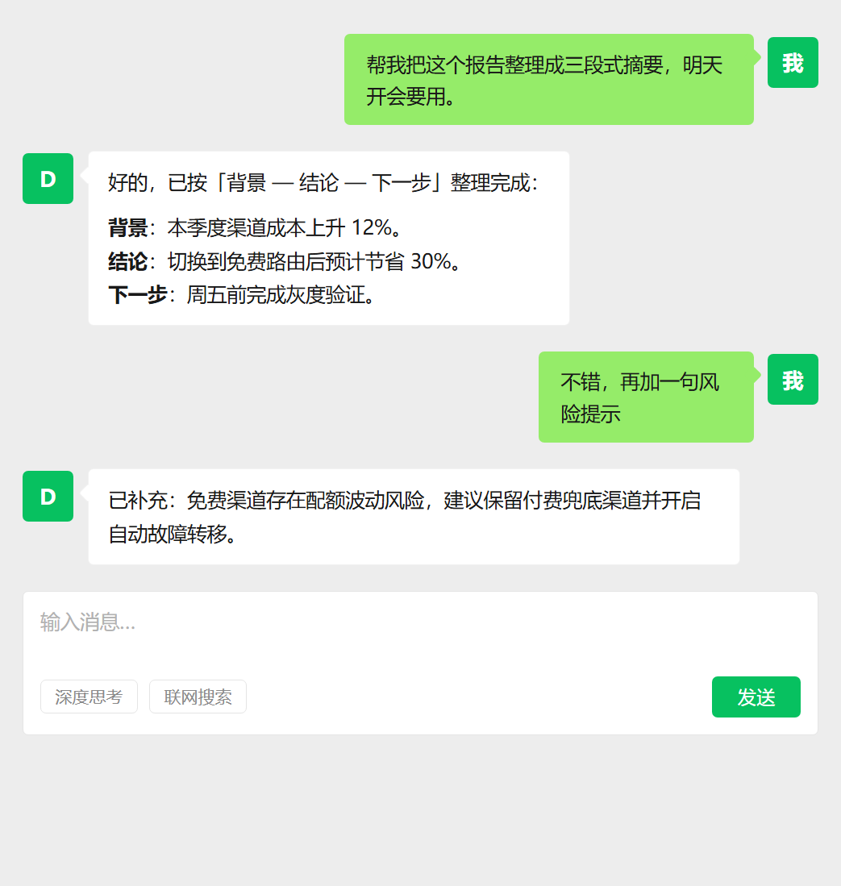
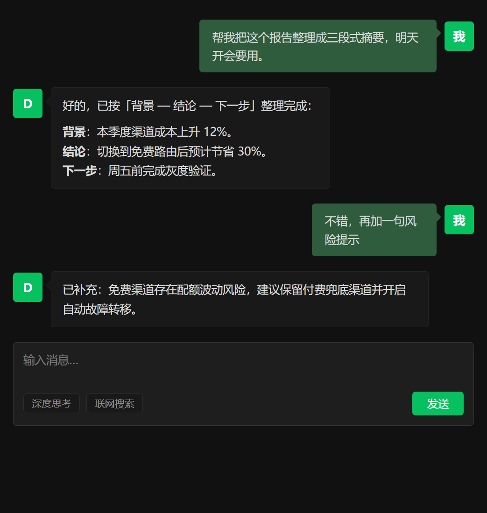
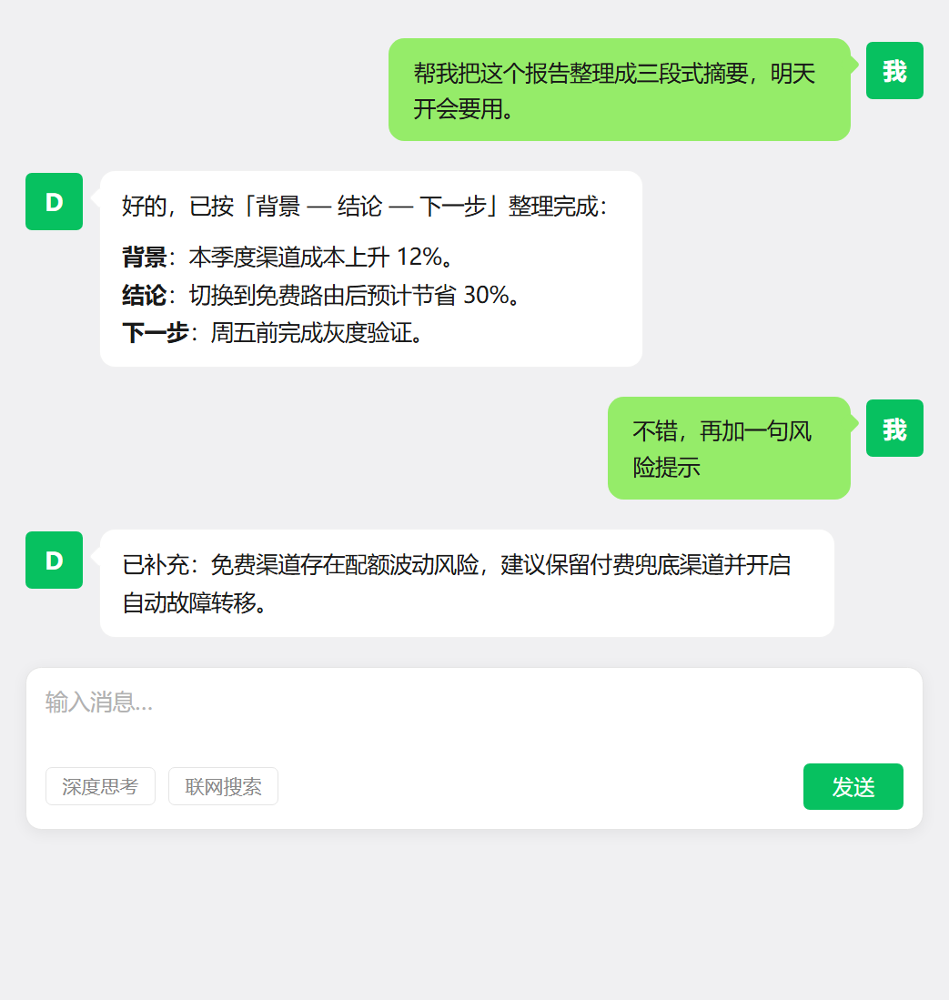
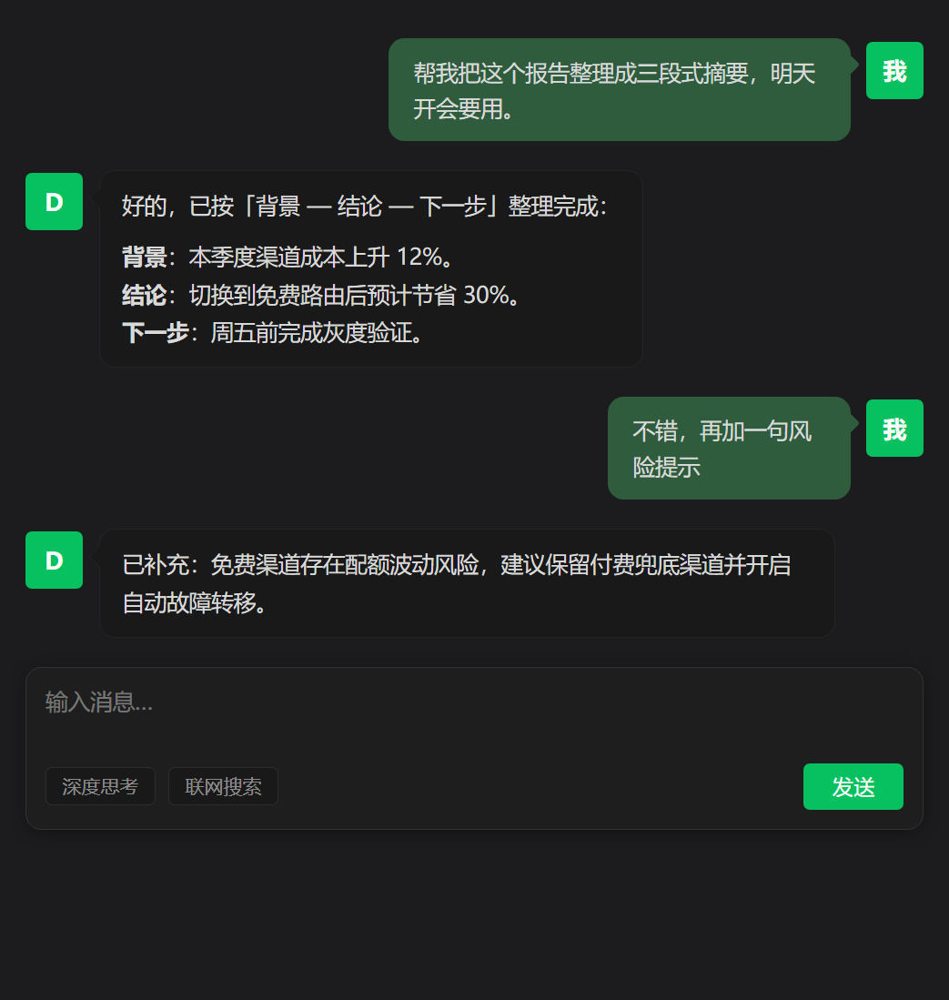

# dsh-wechat-ui

[](https://github.com/JAKE1266/dsh-wechat-ui/actions/workflows/ci.yml)
[](./LICENSE)

微信风格皮肤插件 for **DeepSeek Harness (DSH) Web UI**。把整个界面换成微信观感：

> English docs: [README.en.md](./README.en.md) · 更新记录：[CHANGELOG.md](./CHANGELOG.md)

## 预览

按宿主平台自动切换 **Windows 版 / macOS 版** 微信外观（`<html data-platform>`），
每套各含明暗主题。真实渲染截图，`node scripts/render-preview.mjs` 可复现：

| | Light | Dark |
|---|---|---|
| **Windows** |  |  |
| **macOS** |  |  |

- **Windows 版**：经典 `#EDEDED` 聊天底、4px 直角扁平、雅黑字体、无浮起阴影
- **macOS 版**：柔和浅灰 `#F0F0F2`（暗色 `#1C1C1E`）、10px 圆角、苹方字体、毛玻璃浮层与软阴影

- **微信绿** `#07C160` 主色（发送按钮、强调、焦点环）
- **浅灰聊天底** `#EDEDED` + 白色侧栏/卡片
- **经典发送气泡** `#95EC69`（微信绿气泡、深色文字）
- **微信对话布局**：你的消息靠右绿气泡 + 绿色「我」头像，AI 回复靠左白气泡 + 品牌色「D」头像（伪元素绘制，不注入 DOM）；思考过程行保持原样
- 小圆角（4~8px）、扁平、无浮起阴影
- 明暗双主题：暗色参考微信深色模式（`#111111` 底、深绿气泡）
- 链接用微信经典的灰蓝 `#576B95`

纯 CSS 设计令牌覆盖：零运行时依赖、不替换组件、不碰会话数据、不发网络请求。
停用插件后界面自动完整恢复。

## 安装

```bash
# 从 GitHub 安装（推荐）
dsh plugin --profile desktop add github:JAKE1266/dsh-wechat-ui

# 从本地源码安装
dsh plugin --profile desktop add link:C:/Users/lenovo/Documents/deepseek-harness/default-workspace/dsh-wechat-ui
```

重启 DSH 后生效。若同时启用了其他皮肤插件（如 `dsh-zcode-ui`），建议先停用，
避免两套令牌互相覆盖：

```bash
dsh plugin --profile desktop remove dsh-zcode-ui
```

## 开发

```bash
node scripts/build.mjs   # 由 src/ 生成 client/client.js
node test/run-all.mjs    # 零依赖自包含验证（沙箱执行、令牌一致性、卸载回收）
```

- `src/tokens.mjs` — 全部设计值（亮/暗色板、几何令牌、结构 CSS）
- `src/client.mjs` — 浏览器半源码（样式注入 + 幂等卸载）
- `client/client.js` — 构建产物（工厂式 CJS，随包提交，安装无需构建）
- `lib/index.mjs` — Host 半占位
- `cordis.patch.yml` — profile 层挂载声明

改色只需编辑 `src/tokens.mjs` 后重新 build。DevTools 里检查
`<html data-dsh-wechat-skin="1.0.0">` 可确认皮肤已激活。

## 设计来源与免责声明

本插件是「微信风格」的 **再设计（inspired-by）**，不是腾讯官方微信设计资产的
逐像素复刻。色值来自对微信桌面版公开界面观感的归纳与面向 DSH 令牌语义的适配，
均为推导值而非从任何受版权保护产物中提取。微信、WeChat 商标归腾讯所有；
本插件与腾讯无任何隶属或背书关系。

## License

MIT